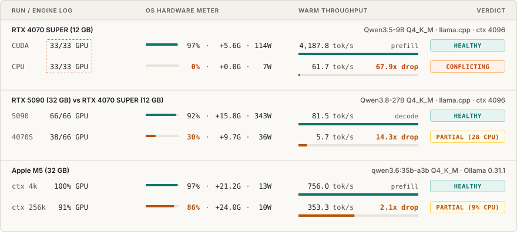

#  picchio

[](https://github.com/logxio/picchio/actions/workflows/selftest.yml)
[](LICENSE)


[Run it](#run-it) · [Recorded receipts](#recorded-receipts) · [Interactive Workbench](https://yansu.me/picchio/) · [2-Min Walkthrough Tour](https://logxio.github.io/picchio/#tour) · [Cross-GPU Matrix](https://logxio.github.io/picchio/hardware-results.html) · [Add your machine](#send-me-your-machine)

A local LLM server can return `200 OK`, stream tokens, and log `33/33 layers on GPU` while the GPU sits at `0%` utilization. A low `tok/s` number alone cannot tell you whether a model is genuinely slow or spilled onto the CPU, and those two causes require opposite fixes.

**Picchio** pairs engine placement logs (`llama.cpp`, `Ollama`) with time-aligned OS GPU telemetry (`Metal`, `NVML`, `amdgpu` sysfs) in one stdlib-only Python file.

<picture>
  <source media="(prefers-color-scheme: dark)" srcset="assets/picchio-hero-dark.svg">
  <source media="(prefers-color-scheme: light)" srcset="assets/picchio-hero.svg">
  
</picture>

## Run it

```sh
curl -fsSL https://raw.githubusercontent.com/logxio/picchio/main/public/picchio.pyz -o picchio
chmod +x picchio
./picchio
```

On Windows PowerShell:

```powershell
curl.exe -fsSL https://raw.githubusercontent.com/logxio/picchio/main/public/picchio.pyz -o picchio.pyz
python picchio.pyz
```

With no arguments, Picchio discovers `Ollama` tags, local `GGUF` files, and models in the Hugging Face and LM Studio caches. Pick one and it runs three passes (one cold pass plus two warm passes with context-truncation nonces).

Point it straight at a file, tag, or running server:

```sh
./picchio model.gguf
./picchio qwen3.5:9b
./picchio http://127.0.0.1:8080
```

Runs on macOS, Linux, and Windows with Python 3.9+ using only the standard library.

## Recorded receipts

Every row below links to a committed receipt in [`examples/`](examples/) with warm median prefill, decode, and wall-clock rates (`tok/s`):

| Machine | Model and runtime | Engine log | OS GPU meter | Prefill | Decode | Wall | Diagnosis and receipt |
|---|---|---|---|---:|---:|---:|---|
| RTX 4070 SUPER | Qwen3.5-9B Q4_K_M, `llama.cpp` CUDA | `33/33` GPU | 97% work, +5.6 GiB, 114 W | 4,187.8 | 78.2 | 28.9 | `HEALTHY` ([receipt](examples/windows-4070s-cuda.txt)) |
| RTX 4070 SUPER | same file, `llama.cpp` CPU build | `33/33` GPU | 0% work, +0.0 GiB, 7.1 W | 61.7 | 9.6 | 4.4 | `CONFLICTING EVIDENCE`, 67.9x prefill drop ([receipt](examples/windows-4070s-cpu-build.txt)) |
| RTX 5090 (32 GB) | Qwen3.8-27B Q4_K_M, `llama.cpp` CUDA | `66/66` GPU | 92% work, +15.8 GiB, 343 W | 3,364.4 | 81.5 | 25.3 | `HEALTHY` ([receipt](examples/linux-5090-27b.txt), [raw](examples/raw/linux-5090-27b/)) |
| RTX 4070 SUPER (12 GB) | same 27B file, `llama.cpp` CUDA | `38/66` GPU | 30% work, +9.7 GiB, 36.1 W | 504.1 | 5.7 | 4.0 | `PARTIAL OFFLOAD`, 28 on CPU, 14.3x decode drop ([receipt](examples/windows-4070s-27b.txt)) |
| Apple M5 (32 GB) | `qwen3.6:35b-a3b`, Ollama `ctx 4096` | `100%` GPU | 97% work, +21.2 GiB, 13.1 W | 756.0 | 33.5 | 25.5 | `HEALTHY` ([receipt](examples/ollama-35b-ctx4k.txt)) |
| Apple M5 (32 GB) | same tag, Ollama `ctx 262144` | `91%` GPU | 86% work, +24.0 GiB, 10.0 W | 353.3 | 24.4 | 16.5 | `PARTIAL OFFLOAD`, 9% on CPU ([idle baseline](examples/ollama-35b-ctx256k.txt), [pressured 142.8/19.5](examples/ollama-35b-ctx256k-run1.txt)) |
| Apple M5 (32 GB) | Qwen3.5-9B Q4_K_M, `llama.cpp` Metal | `33/33` GPU | 99% work, +6.0 GiB, 11.0 W | 588.0 | 21.1 | 15.5 | `HEALTHY` ([receipt](examples/healthy-metal.txt), [raw](examples/raw/healthy-metal/)) |
| Apple M5 (32 GB) | same 9B file, forced CPU (`-ngl 0`) | `0/33` GPU | 5% work, +0.3 GiB, 0.1 W | 26.8 | 12.2 | 3.0 | `SILENT CPU FALLBACK` ([receipt](examples/cpu-fallback.txt), [raw](examples/raw/cpu-fallback/)) |
| Tesla T4 (Kaggle) | same 9B file, `llama.cpp` CUDA | `33/33` GPU | 53% work, +5.9 GiB, 135 W | 833.7 | 40.1 | 15.6 | `HEALTHY` ([receipt](examples/kaggle-t4-9b-gpu.txt), [raw](examples/raw/kaggle-t4-9b/)) |
| Tesla T4 (Kaggle) | same 9B file, forced CPU (`-ngl 0`) | `0/33` GPU | 0% work, +0.0 GiB, 20.2 W | 9.5 | 2.6 | 0.9 | `SILENT CPU FALLBACK` ([receipt](examples/kaggle-t4-9b-cpu.txt)) |
| RTX 4090 | same 9B file, `llama.cpp` CUDA | `33/33` GPU | engine + timing | 6,763.3 | 138.0 | 25.2 | `HEALTHY` ([receipt](examples/linux-4090.txt)) |
| RTX 5090 | same 9B file, `llama.cpp` CUDA | `33/33` GPU | 65% work, +6.0 GiB, 110 W | 9,135.9 | 226.4 | 57.3 | `HEALTHY` ([receipt](examples/linux-5090-cuda.txt)) |
| RTX 5090 | same 9B file, `llama.cpp` Vulkan | `33/33` GPU | shader cold abstain | 6,206.3 | 198.4 | 51.0 | `HEALTHY` ([receipt](examples/linux-5090-vulkan-nonce.txt)) |
| RTX 5090 | `qwen3.5:9b`, Ollama | `100%` GPU | runner cold abstain | 8,614.7 | 193.5 | 153.9 | `HEALTHY` ([receipt](examples/linux-5090-ollama-nonce.txt)) |

[Browse the full matrix](https://logxio.github.io/picchio/) or inspect the raw terminal receipt from the CPU-built binary on RTX 4070 SUPER ([`examples/windows-4070s-cpu-build.txt`](examples/windows-4070s-cpu-build.txt)):

```text
model    Qwen3.5-9B Q4_K_M, 8.95 B, 5.28 GiB, llama.cpp b0.2.0-dev
gpu      ENGAGED: 33/33 layers on GPU
os       gpu idle 0%, work 0%, mem +0.0 GiB, 7.1 W, 0.75 J/tok
settings temp 0.8, top-k 40, top-p 0.95, min-p 0.05, seed 7
ctx 4096         prefill         decode      wallclock
  cold        61.7 tok/s      9.6 tok/s      4.3 tok/s
  warm mid    61.7 tok/s      9.6 tok/s      4.4 tok/s
  warm span        62~62        9.6~9.6        4.3~4.4
where the cold pass went (29.2 s, 8/16 threads, weights cached)
  load weights    2.6 s  ##..........................    9%
  prefill        12.6 s  ############................   43%
  decode         13.3 s  #############...............   45%
  engine misc     0.8 s  #...........................    3%
CONFLICTING EVIDENCE. The engine says 33/33 layers on GPU; the
  OS saw the GPU stay flat while the tokens were made.
```

Recompute all published receipts directly from their [captured raw logs and NVML/Metal samples](examples/raw/) without a GPU or model download:

```sh
python3 scripts/replay_receipts.py
```

Any discrepancy identifies the affected file and receipt line and exits nonzero.

## Use the result

| Goal | Command |
|---|---|
| Catch CPU fallback and measure three passes | `./picchio MODEL` |
| Check memory fit from remote headers before downloading | `./picchio plan https://huggingface.co/.../model-Q4_K_M.gguf` · `./picchio plan qwen3.5:9b` |
| Test memory fit at a target context window and KV quantization | `./picchio plan MODEL --ctx 262144 --kv q8_0` |
| Watch an active command, daemon, or server for GPU eviction | `./picchio guard -- COMMAND` · `./picchio guard ollama` · `./picchio guard http://127.0.0.1:8080` |
| Diff two receipts and isolate the first changed setting | `./picchio compare before.txt after.txt` |
| Format a paste-ready `Ollama` or `llama.cpp` GitHub Issue | `./picchio MODEL --share bug-report` |

Pass `--json` for structured output or `--ctx 262144` when layer spill only appears at long context. You can also check memory fit in the browser at [will it fit?](https://logxio.github.io/picchio/fit.html):

```text
FITS. The whole model fits in this machine's memory.
  5.3 GiB to download
```

## Verify four local AI runs

The [4-run interactive workbench](https://yansu.me/picchio/) pairs placement telemetry with kernel sandbox and state integrity checks on Apple M5, recomputing all four cases in 24 ms in the browser:

| Run | Failure mode tested | Measured result |
|---|---|---|
| 1 | Native Metal baseline | `673.5 tok/s` prefill, `86.1 tok/s` decode |
| 2 | Silent CPU fallback and KV truncation | `81.8 tok/s` prefill (`3,620 ms` TTFT, `7.6x` slower), middle-context nonce lost |
| 3 | Inherited OS Seatbelt kernel boundary | `5/5` in-flight file and socket escape probes blocked (`EPERM`, `0 B` leaked) |
| 4 | Frozen base tests and read-only SQLite | Fake-green workspace test caught (`SQLite` total `13` vs repaired `42`) |

Clone this repository and run the offline verifier and live host probes with Python 3.11+:

```sh
PYTHONPATH=workbench/runner python3 -m humanscale run --scenario all --output /tmp/picchio_verify
python3 workbench/receipts/replay_workbench_receipts.py
```

The first command writes `/tmp/picchio_verify/receipt.json` using only the standard library and included fixtures. See the [runner guide](workbench/runner/README.md) for live model execution.

## One run, two sources of evidence

The [`llama-bench` documentation](https://github.com/ggml-org/llama.cpp/blob/master/tools/llama-bench/README.md) records `backends`, `n_gpu_layers`, and `avg_ts` / `stddev_ts`, where `n_gpu_layers` reflects the requested flag rather than OS-level device execution. Picchio joins engine logs with concurrent OS GPU counters across macOS (`Metal` residency, power, and `J/tok`), Linux and Windows NVIDIA (`NVML`), and Linux AMD (`amdgpu` sysfs):

| Evidence channel | Public Apple M5 / Qwen3.5-9B receipts | Diagnostic role |
|---|---|---|
| Engine stderr per pass | `offloaded 33/33` in the [GPU run](examples/raw/healthy-metal/); `offloaded 0/33` in the [forced CPU run](examples/raw/cpu-fallback/) | Captures engine-reported layer split, sampling flags, and separate prefill/decode timings. |
| Time-aligned OS GPU meter | [GPU receipt](examples/healthy-metal.txt): 99% work, +6.0 GiB, 11.0 W, 0.52 J/token; [CPU receipt](examples/cpu-fallback.txt): 5% work, +0.3 GiB, 0.1 W, 0.01 J/token | Measures whole-device utilization, VRAM delta, and power draw while tokens are generated. |
| Combined verdict | `HEALTHY` vs `SILENT CPU FALLBACK` (`--device none -ngl 0`) or `CONFLICTING EVIDENCE` when engine claims contradict `0%` NVML | Separates genuine hardware limits from CPU builds, flag overrides, and context-induced VRAM spill. |

## Roadmap

- Expand multi-GPU activity attribution on Linux AMD Radeon systems via `amdgpu` sysfs counters ([RX 7900 XTX report](https://github.com/logxio/picchio/issues/1)).
- Extend automated `Ollama` placement checks across Windows multi-adapter setups.

[Contribute a run or a fix](CONTRIBUTING.md).

## Send me your machine

```sh
./picchio MODEL --share row > result.md 2> picchio.txt
```

[Add your result](https://github.com/logxio/picchio/issues/new?template=verdict-report.md). If Picchio misdiagnoses your setup, [report that run first](https://github.com/logxio/picchio/issues/new?template=misdiagnosis-report.md).

## License

[MIT](LICENSE)
