<div align="center">


<h1>Inference Placement Receipts for local LLMs</h1>

<p>
<a href="https://github.com/logxio/picchio/actions/workflows/selftest.yml"></a>
<a href="LICENSE"></a>

</p>

<p><a href="#run-it">Run it</a> · <a href="https://yansu.me/picchio/">Interactive Workbench</a> · <a href="https://logxio.github.io/picchio/#tour">2-Min Walkthrough Tour</a> · <a href="https://logxio.github.io/picchio/hardware-results.html">Cross-GPU Matrix</a> · <a href="#send-me-your-machine">Add your machine</a></p>

<p>An inference placement and sandbox boundary receipt joins the engine's layer placement (Metal, CUDA, ROCm, or CPU fallback), OS GPU power/busy sampling, context-truncation nonce verification, inherited OS Seatbelt kernel boundary probes (5/5 in-flight file and network escape probes blocked with 0 B leaked), and frozen base-test plus read-only SQLite state verification. It shows where a local model actually ran and whether its task claim is genuine when a single tok/s number or green workspace test cannot. A 27B model still answered at 5.7 tok/s, but its <a href="examples/windows-4070s-27b.txt">recorded receipt</a> showed 28 of 66 layers on the CPU and a memory-fit cause; on Apple M5, our <a href="https://yansu.me/picchio/">4-run interactive workbench</a> recomputes native Metal repair (673.5 tok/s prefill, 86.1 tok/s decode), silent CPU fallback and middle-context nonce loss (81.8 tok/s prefill, 3,620 ms TTFT), in-flight kernel boundary blocking (5/5 EPERM), and fake-green test tampering detection (SQLite 13 vs 42) in 24 ms in the browser.</p>



</div>

A separate [Linux CUDA 27B receipt](examples/linux-5090-27b.txt) records all
66 layers on an RTX 5090, 92% GPU work and 81.5 tok/s warm decode. Its
[three captured passes and NVML samples](examples/raw/linux-5090-27b/) are
public alongside the Apple M5 GPU and forced-CPU runs.

An [author-run Kaggle Linux T4 pair](examples/raw/kaggle-t4-9b/) held the
same Qwen3.5-9B file and exact per-pass prompts: the [GPU receipt](examples/kaggle-t4-9b-gpu.txt)
shows 33/33 layers and 40.1 tok/s warm decode, while the
[forced-CPU receipt](examples/kaggle-t4-9b-cpu.txt) shows 0/33 and
2.6 tok/s; recalculate these captured receipts without a GPU or model download:

```sh
python3 scripts/replay_receipts.py
```

The command checks each published receipt against its [captured inputs](examples/raw/).
A mismatch points to the affected file or receipt line and exits nonzero.

## Run it

```sh
curl -fsSL https://raw.githubusercontent.com/logxio/picchio/main/public/picchio.pyz -o picchio
chmod +x picchio
./picchio
```

On Windows, in PowerShell:

```powershell
curl.exe -fsSL https://raw.githubusercontent.com/logxio/picchio/main/public/picchio.pyz -o picchio.pyz
python picchio.pyz
```

With no arguments, Picchio finds Ollama tags, local GGUF files and models in
the Hugging Face and LM Studio caches. Pick one and it runs three passes.

You can also point it straight at a model or a running server:

```sh
./picchio model.gguf
./picchio qwen3.5:9b
./picchio http://127.0.0.1:8080
```

It runs on macOS, Linux and Windows with Python 3.9+. The download is one
file and uses only the standard library.

## Roadmap

- Expand multi-GPU activity attribution on Linux AMD Radeon systems via `amdgpu` sysfs counters ([RX 7900 XTX report](https://github.com/logxio/picchio/issues/1)).
- Extend automated Ollama placement checks across Windows multi-adapter setups.

[Contribute a run or a fix](CONTRIBUTING.md).

## Use the result

| I want to… | Run |
|---|---|
| catch CPU fallback and measure the run | `./picchio MODEL` |
| know whether a model fits here before I download it | `./picchio plan https://huggingface.co/.../model-Q4_K_M.gguf` · `./picchio plan qwen3.5:9b` |
| check that fit at my own context and KV type | `./picchio plan MODEL --ctx 262144 --kv q8_0` |
| guard something already running and get told the moment it leaves the GPU: your own command, a loaded model, a server | `./picchio guard -- COMMAND` · `./picchio guard ollama` · `./picchio guard http://127.0.0.1:8080` |
| compare two runs and show the first changed setting | `./picchio compare before.txt after.txt` |
| turn one run into a complete Ollama or llama.cpp Issue report | `./picchio MODEL --share bug-report` |

Add `--json` when you want machine-readable output.
Add `--ctx 262144` when the problem only appears at a larger context.

The fit check answers before the download, from the file header and the
registry manifest, and it answers in one word and one move. In the
browser: [will it fit?](https://logxio.github.io/picchio/fit.html)

```
FITS. The whole model fits in this machine's memory.
  5.3 GiB to download
```

## Verify four local AI runs

Clone this repository and run the workbench checks with Python 3.11 or newer:

```sh
PYTHONPATH=workbench/runner python3 -m humanscale run --scenario all --output /tmp/picchio_verify
python3 workbench/receipts/replay_workbench_receipts.py
```

This verifies four captured Apple M5 receipts and runs fresh host boundary and frozen SQLite checks, including the fake green result at 13 and the repaired total of 42. The first command writes `/tmp/picchio_verify/receipt.json`. It uses the standard library and the included receipts. See the [runner guide](workbench/runner/README.md) for fresh model inference.

## What it gives you

- the exact number of model layers on the GPU
- separate prefill, decode and wall-clock speeds
- GPU activity, memory, power and energy per generated token
- the first setting that changed when you compare two runs
- a clear `HEALTHY`, `CPU FALLBACK` or `PARTIAL OFFLOAD` result
- a paste-ready GitHub Issue with your machine, model, GPU placement and measured rates

## Compare machines

I measured these with Picchio:

| machine | model and engine | placement | prefill | decode | wall-clock |
|---|---|---|---:|---:|---:|
| Apple M5 | Qwen3.5-9B, llama.cpp Metal | 33/33 | 588.0 | 21.1 | 15.5 |
| Apple M5 | same file, forced CPU | 0/33 | 26.8 | 12.2 | 3.0 |
| RTX 4090 | same file, llama.cpp CUDA | 33/33 | 6763.3 | 138.0 | 25.2 |
| RTX 5090 | same file, llama.cpp CUDA | 33/33 | 9135.9 | 226.4 | 57.3 |
| RTX 5090 | same file, llama.cpp Vulkan | 33/33 | 6206.3 | 198.4 | 51.0 |
| RTX 5090 | qwen3.5:9b, Ollama | 100% GPU | 8614.7 | 193.5 | 153.9 |
| RTX 4070 SUPER | same file, llama.cpp CUDA | 33/33 | 4187.8 | 78.2 | 28.9 |
| your machine | | | | | |

[Open every result](https://logxio.github.io/picchio/) or compare the outputs
in [examples/](examples/).

## What Picchio reads

- llama.cpp: per-layer placement, applied sampling settings and timing
- Ollama: CPU/GPU weight split and timing
- macOS: Apple GPU activity, memory, power and energy per token
- NVIDIA on Linux and Windows: GPU activity, memory, power and energy per token through NVML
- AMD on Linux: GPU activity and memory through amdgpu sysfs

Point Picchio at a GGUF path, an Ollama tag or a running llama-server URL.
The result tells you where the model ran and which number is safe to compare.

### One run, two sources of evidence

The [llama-bench documentation](https://github.com/ggml-org/llama.cpp/blob/master/tools/llama-bench/README.md) reports `backends`, `n_gpu_layers`, and repeated-test `avg_ts` / `stddev_ts` output, where `n_gpu_layers` is a requested flag rather than an OS measurement of GPU execution. Picchio pairs the inference engine's stderr placement log with time-aligned OS GPU telemetry during the same run:

| Input and source | Output in the public Apple M5 / Qwen3.5-9B receipts | Telemetry role |
|---|---|---|
| llama.cpp stderr from each pass | `offloaded 33/33` with prompt/eval timings in the [GPU run](examples/raw/healthy-metal/); `offloaded 0/33` in the [forced CPU run](examples/raw/cpu-fallback/) | Records engine-level layer placement and separate prompt/decode timings. |
| Picchio's time-aligned OS GPU samples | [GPU run](examples/healthy-metal.txt): 99% work, +6.0 GiB, 11.0 W, 0.52 J/token; [forced CPU run](examples/cpu-fallback.txt): 5% work, +0.3 GiB, 0.1 W, 0.01 J/token | Captures whole-device GPU utilization, VRAM delta, and power draw alongside the engine log. |
| Picchio's combined diagnosis | `HEALTHY` versus `SILENT CPU FALLBACK`, with `--device none -ngl 0` identified in the CPU run | Flags mismatches between requested offload flags, actual layer placement, and device activity. |

## Send me your machine

```sh
./picchio MODEL --share row > result.md 2> picchio.txt
```

[Add your result](https://github.com/logxio/picchio/issues/new?template=verdict-report.md).
If Picchio calls your run wrong, [send me that one first](https://github.com/logxio/picchio/issues/new?template=misdiagnosis-report.md).

## License

[MIT](LICENSE)
